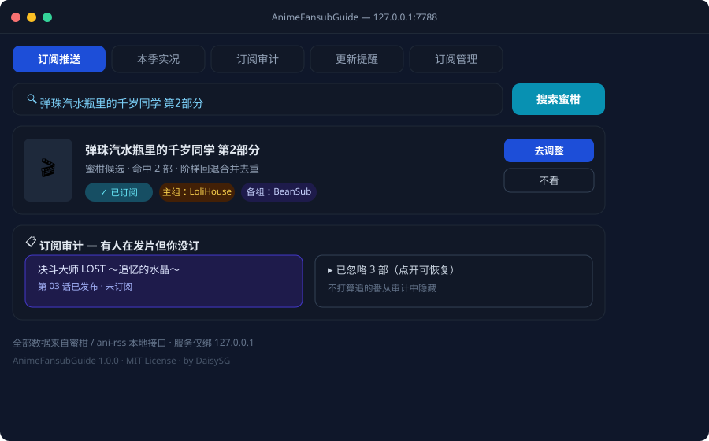
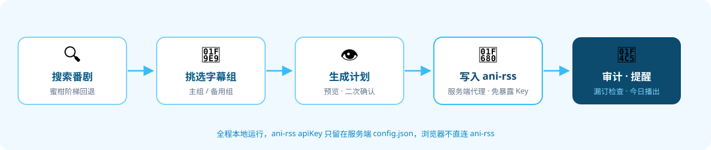

<div align="center">


# AnimeFansubGuide

**本地运行的番剧订阅助手 · 蜜柑候选搜索 + ani-rss 订阅审计**


</div>

---

一个跑在自己电脑上的番剧订阅面板：本季新番实况、订阅审计、更新提醒、订阅推送（一键写进 ani-rss），
全部由**一个 Python 服务 + 一个单文件网页**提供，不依赖任何云服务。

前端是单文件页面（`anime-fansub-guide.html`），由本地 Python 服务（`app/anime_fansub_server.py`）托管；
服务同时充当 ani-rss 的代理桥 —— 浏览器不直连 ani-rss，**apiKey 只留在服务端**。

## ⬇️ 下载即用（Windows）

不想装 Python？直接拿走打包好的单文件 exe，双击就能跑：

**[⬇️ 前往 Releases 下载](https://github.com/DaisySG297/AnimeFansubGuide/releases/latest)** ｜ 仓库内打包脚本：[`scripts/build-exe.ps1`](scripts/build-exe.ps1)

| 资产 | 大小 | 说明 |
|------|------|------|
| `AnimeFansubGuide.exe` | 约 8.8 MB | PyInstaller 单文件，双击启动后浏览器打开 `http://127.0.0.1:7788/` |

> 首次运行会在 exe 同目录生成 `config.json`（模板见 [`app/config.example.json`](app/config.example.json)），填好 ani-rss 地址与 apiKey 即可。

## ✨ 功能特性

- 🔍 **蜜柑搜索阶梯** — 长标题 / 带季数后缀 / 中英混排的标题在蜜柑常常 0 命中，服务端按
  「原名 → 去季数 → 剥尾部语气词 → 中文词段 / 英文词段 → 尾 4·首 4 字」逐级回退并合并去重
- 📺 **本季实况** — 本季新番 × 字幕组发布动态，一眼看清谁在发、发到第几话
- 📋 **订阅审计** — 找出「有人在发片但你没订」的番，以及「已订阅但缺备用组」的番；不打算追的可以「不看」忽略
- 🔔 **更新提醒** — 今日播出 + Emby 在库对照，可推送到钉钉
- 🗑️ **订阅管理** — 老订阅批量退订，删除前自动镜像 ani-rss 去重记录
- 🔒 **凭据不外泄** — ani-rss apiKey / qBittorrent API Key 只存在于服务端 `config.json`
- 🛡️ **安全闸门** — 本地服务只绑 `127.0.0.1`，校验 `Host` 头，POST 校验 `Origin`
- 🪶 **零第三方依赖** — 仅用 Python 标准库，单文件服务 + 单文件前端

## 🖥️ 运行效果

五个视图各管一摊：搜索挑组、看本季动态、查漏补订、盯今日播出、清理老订阅。

<div align="center">

</div>

## 🔄 工作流程

<div align="center">

</div>

## 🚀 使用方法

### 环境要求

- Python 3.8 及以上（源码运行）；或用打包好的 exe 免装环境

### 快速开始

```bash
# 1) 准备配置：复制模板并填写 ani-rss 地址与 apiKey
cp app/config.example.json app/config.json

# 2) 启动（默认监听 127.0.0.1:7788）
python app/anime_fansub_server.py

# 3) 浏览器打开
#    http://127.0.0.1:7788/
```

ani-rss 的 apiKey 在其数据目录的 `config.v2.json` 里（字段 `apiKey`），
请求头用 `X-Api-Key: <apiKey>`。

### 配置说明

| 配置项 | 说明 | 默认值 |
|--------|------|--------|
| `anirssBase` | ani-rss 服务地址 | `http://127.0.0.1:7789` |
| `anirssApiKey` | ani-rss 的 apiKey（只留在服务端） | — |
| `port` | 面板监听端口 | `7788` |
| `enableHttps` | 是否同时开 HTTPS（默认 7790） | `false` |
| `authUser` / `authPass` | HTTP Basic 认证（本机回环免认证） | — |
| `embyBase` / `embyApiKey` | Emby 地址与密钥（更新提醒对照在库，可留空） | — |
| `dingTalkWebhook` | 钉钉机器人 Webhook（推送提醒，可留空） | — |

### 本季快照数据

「本季实况」读的是 `season-data.js`，由脚本抓取生成（**未随仓库提供**，因为数据每天都变）：

```bash
# Node 环境下聚合本季快照 → season-data.js
node scripts/build-season.js

# 或 Windows 计划任务定时抓取（推荐每半小时）
powershell -File scripts/refresh-season.ps1
```

## 📦 打包为独立 EXE

```powershell
# 一键打包（内部调用 PyInstaller），产出 dist/AnimeFansubGuide.exe
powershell -File scripts/build-exe.ps1
```

打包前会自动把 `dist/config.json` 备份到 `dist/config-backups/`，避免覆盖你的配置。

## 📁 目录结构

```
anime-fansub-guide.html      前端单页（所有视图 + 样式 + 脚本）
app/anime_fansub_server.py   本地服务：静态托管 + ani-rss 代理 + 审计/推送
app/reminder.py              更新提醒（Emby 在库对照 / 钉钉推送）
app/config.example.json      配置模板
scripts/build-season.js      聚合本季快照 → season-data.js
scripts/refresh-season.ps1   定时抓取（本季快照数据源）
scripts/build-exe.ps1        PyInstaller 打包成单文件 exe
docs/                        README 配图（banner / flow / screenshot）
season-data.js               本季快照数据（由脚本生成，未随仓库提供）
```

## 🔐 设计要点

- **凭据不外泄** — ani-rss apiKey / qBittorrent API Key 只存在于服务端 `config.json`
- **安全闸门** — 本地服务只绑 `127.0.0.1`，校验 `Host` 头，POST 校验 `Origin`
- **删除保护** — ani-rss 的 `deleteAni` 会无条件清掉下载去重记录，
  退订前先跑 `ani_rss_tool.py mirror` 备份，避免重订时全量重下
- **搜索降级** — 蜜柑对长标题匹配很脆弱，阶梯回退 + 按 url 合并去重是命中率的关键

## 🙏 鸣谢

- [ani-rss](https://github.com/wushuo894/ani-rss) — 本项目的订阅后端与蜜柑搜索数据源，面板的推送 / 审计 / 管理全部围绕它的 API 展开
- [Mikan Project（蜜柑计划）](https://mikanani.me/) — 番剧字幕组资源的聚合站，搜索与发布动态的数据来源
- [Bangumi 番组计划](https://bgm.tv/) — 番剧条目与元数据对齐的参考基准
- [Emby](https://emby.media/) — 媒体库管理与刮削，更新提醒的「在库对照」依赖它
- [PyInstaller](https://pyinstaller.org/) — 让面板可以打包成免安装的单文件 exe
- 各汉化字幕组 / 压制组 — 番剧中文字幕与压制资源的源头，本工具处理的正是他们的劳动成果
- 所有为本项目提出建议与反馈的朋友

## ⚠️ 免责声明

本项目只做 RSS 订阅与元数据聚合，**不存储、不分发任何影视资源**。
字幕组评价为社区口碑的归纳，不代表官方评价。请支持正版。

## 📄 开源协议

本项目基于 [MIT License](LICENSE) 开源，欢迎自由使用、修改与分发。

<div align="center">

**如果这个工具对你有帮助，欢迎点一个 ⭐ Star 支持一下！**

</div>
